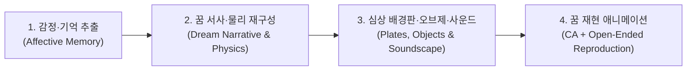

# DreamModel · Collective Dreaming 통합 가이드

> **인간의 감정과 기억이 어떻게 하나의 '살아 숨 쉬는 꿈의 공간과 사물'로 재구성되고 재현되는가**
>
> 본 문서는 **집단 공감 기억 기반 꿈 생성 및 재현 프로젝트(Collective Dreaming)**의 전체 흐름을 포괄적으로 설명하고, 특히 **꿈 재현 — 배경 시스템(Open-Ended + Close-Ended 셀룰러 오토마타 공간 엔진)**과 **오브제 발달 시스템**이 어떤 원리로 작동하는지 누구나 쉽게 이해할 수 있도록 정리한 통합 안내서입니다.

---

## 1. 프로젝트 포괄적 이해 (쉬운 통합 설명)

우리가 꾸는 꿈은 현실을 카메라로 찍은 비디오처럼 또렷하고 고정되어 있지 않습니다.
꿈속의 배경 공간은 **기억이 떠오르는 부분만 점과 선으로 선명해지고**, 오래 바라본 곳은 **서서히 잊히며 안개나 입자로 흩어지고**, 전혀 다른 두 장소의 기억이 **서로 겹쳐지거나 소리에 반응해 일렁이는 살아있는 생태계**와 같습니다. 그리고 그 무대 위에서 책, 손, 그림자 같은 **오브제(상징적 사물)**들이 배경과는 또 다른 속도와 움직임으로 자라나고 변형됩니다.

본 프로젝트는 이러한 **인간의 기억과 꿈의 메커니즘**을 다음 4단계로 구현합니다.



### ① 감정·기억 추출 (Affective Memory Extraction)
- 내레이션과 시청각 자극을 경험하는 관객들의 표정 변화에서 **7가지 기본 감정**(기쁨·슬픔·분노·공포·놀람·혐오·중립)을 실시간으로 분석합니다.
- 여러 사람의 감정이 동시에 공명하는 **공감 피크(Empathy Peak)** 구간을 찾아내고, 그 순간의 기억 키워드들을 조합해 초기 꿈의 설계도를 진화 탐색으로 도출합니다.

### ② 꿈 서사 및 초현실 물리 법칙 재구성 (Dream Storyboard & Surreal Physics)
- 추출된 4개의 핵심 공감 피크를 **기(0:00~1:15) · 승(1:15~2:30) · 전(2:30~3:45) · 결(3:45~5:00)**의 4막 서사로 재구성합니다.
- 이때 **배경(기억의 공간적 무대)**에 대한 이야기와 **오브제(무대 위에서 상호작용하는 사물)**에 대한 이야기를 분리하여 작성합니다. 배경과 오브제는 감정의 결은 공유하지만 완벽히 똑같이 움직이지 않고, 서로 다른 호흡과 변화 속도로 개연성 있게 전개됩니다.
- 각 장면에는 현실과 다른 **꿈속 고유 물리 법칙**(예: *중력이 한 박자 늦게 따라붙는 갑판*, *다가갈수록 멀어지는 복도*, *만질수록 작아지고 무거워지는 구름*, *아래로 떨어지지 않고 지붕으로 떠오르는 물방울*)이 함께 정의됩니다.

### ③ 심상 배경판·오브제 및 사운드스케이프 합성 (Pointillist Plates & Organic Sound)
- 4막의 배경 서사와 감정 색채를 바탕으로, 어둠 속에서 빛의 입자(도트)와 윤곽선이 응집된 **원본 심상 배경판 4장(`scene_01.png` ~ `scene_04.png`)**과 투명 배경의 **독립 오브제 이미지(`objects/`)**를 생성합니다.
- 동시에 각 시나리오의 감정 흐름과 공간의 자연스러운 질감(물결, 빗소리, 나무의 삐걱임, 바람, 심연의 공명)이 어우러진 **시나리오별 고유 5분 사운드스케이프**를 합성합니다.

### ④ 꿈 재현 애니메이션 시스템 (Open-Ended + Close-Ended Dream Reproduction)
- 정적인 심상 배경판과 오브제, 시나리오별 고유 사운드, 서사 물리 법칙을 결합하여 **5분(300.0초, 1920×1080, 30fps, 9,000프레임)** 분량의 꿈 애니메이션을 재현합니다.
- **Close-Ended(닫힌 서사 골격)**가 5분이라는 시간 구조와 기·승·전·결 전환, **3분 15초(`195.0s`) 클라이맥스 반전**, 마지막 소멸의 큰 틀을 잡아준다면, **Open-Ended(열린 자율 진화)**는 그 안에서 매 프레임 공간과 사물의 어느 조각이 기억나고 잊히며 어떻게 변형될지를 **셀룰러 오토마타와 진화 연산**으로 끊임없이 새롭게 만들어냅니다.

---

## 2. 꿈 재현 — 배경 시스템 상세 해설 (쉽게 이해하는 핵심 원리)

> **"정지된 배경 그림이 어떻게 5분 내내 스스로 기억하고, 잊히고, 점묘 입자로 흩어지며 살아 숨 쉬는 꿈의 공간이 되는가?"**

정지된 배경 그림 위에 단순히 화면 흔들림이나 색 필터만 씌우면 관객은 금방 *"멈춰 있는 사진 한 장을 그냥 흔들고 있구나"*라고 느끼게 됩니다.
이를 근본적으로 해결하기 위해, 본 **꿈 재현 — 배경 시스템**([`background_ca_engine.py`](../runtime/background_ca_engine.py), [`background_scene_decomposer.py`](../runtime/background_scene_decomposer.py))은 원본 배경판을 **살아있는 세포들의 격자(Cellular Automata)** 위에 올려놓고 다음 **6가지 원리**로 작동합니다.

### 원리 1. 원본 배경판의 4계층 물리적 분해 (`extract_plate_layers`)
렌더러는 입력받은 원본 배경판(`scene_01~04.png`)에 인위적인 가짜 도형을 덧그리지 않습니다. 대신 원본 이미지를 공간 주파수와 구조에 따라 **4개의 물리적 층**으로 분해합니다.
1. **심층 여백 (`deep_bg`)**: 공간 가장 깊은 곳에 깔린 어둠과 안개 빛깔로, 가장 느리고 묵직하게 호흡합니다.
2. **공간 몸체 (`mid_body`)**: 갑판, 복도 벽, 빛의 통로, 지붕 등 장소의 구조 골격으로, 기억 활성도(`M`)가 높을 때 단단하게 응집됩니다.
3. **점묘 도트 (`high_dots`)**: 원본에 박혀 있는 고휘도 빛 알갱이와 입자 파편으로, 공간 몸체와 **반대 방향(역위상 패럴랙스)**으로 유영하며 깊이감을 만듭니다.
4. **기억 선화 (`lines`)**: 원본 이미지에서 추출한 실제 공간의 윤곽선으로, 손으로 더듬어 기억해 내듯 기억이 번지는 경계선에서 또렷이 피어오릅니다.

### 원리 2. 기억 셀룰러 오토마타(`MemoryCA`)와 '도트 박리(Delamination)' 상전이
화면을 가로 240칸 × 세로 135칸(`8px` 단위)의 **기억 세포 격자**로 나눕니다. 각 세포는 스스로 **발아(기억이 떠오름) → 성장(이웃으로 번짐) → 에너지 고갈(망각) → 재기억**의 생명주기를 거칩니다.
- **비동기 공간 에너지 위상**: 모든 세포가 동시에 켜졌다가 동시에 지치지 않도록, 화면 위치마다 에너지(`E`) 파동의 주기를 다르게 설정했습니다. 덕분에 75초 내내 기억의 중심핵이 한곳에 멈추지 않고 물결처럼 공간을 유영합니다.
- **암전 대신 '도트와 선화로 부서지는 망각'**: 어떤 영역을 오랫동안 기억해 세포의 에너지가 고갈(`ex` 상태)되면, 화면이 단순히 까맣게 꺼지지 않습니다. 단단하게 뭉쳐 있던 **공간 몸체(`mid_body`)가 허물어지면서 수많은 점묘 도트(`high_dots`)와 가느다란 윤곽 선화(`lines`)로 박리되어 흩날립니다.**
- **어긋난 재기억 (`Dm`)**: 잊혔던 세포가 에너지를 회복해 다시 기억날 때는 원래 위치에서 살짝 어긋난 자리(`Dm` 변위)에 재발아하여, 기억을 떠올릴 때마다 조금씩 형태가 달라지는 꿈의 속성을 재현합니다.

### 원리 3. 작았다 커졌다 숨 쉬는 3중 도트 격자(`Lattice`)와 윤곽 선화(`lines`) 유지
점묘(도트) 형식과 선화 스타일이 사운드와 자연스럽게 어우러지도록 3가지 크기의 점묘 격자가 동시에 작동합니다.
- **주 도트 격자 (`8px`, `lat8`)** · **미세 입자 격자 (`4px`, `lat4`)** · **빛망울 보케 격자 (`24px`, `lat24`)**
- 모든 도트는 크기가 고정되어 있지 않고, 각 장면의 감정 호흡(`breath`), 사운드의 중음역 에너지(`mid`), 그리고 타격음(`onset`)에 반응하여 **매 프레임 반지름이 작았다 커졌다 하며 살아있는 유기체처럼 맥동**합니다.
- 동시에 기억이 자라나는 경계선(`front`)에서는 원본의 **윤곽 선화(`lines`)**가 도트 사이를 꿰매듯 유지되어 선화 특유의 서정적인 질감을 지켜냅니다.

### 원리 4. Open-Ended 변형장 진화 (`FieldEvolution`)
배경이 정해진 루프를 반복하지 않도록, 11.5초마다 **18개의 공간 변형 유전자 후보**를 생성하고 **구조적 매끄러움(Fitness)**, **과거 아카이브 대비 새로움(Novelty)**, **생존자 간 다양성(Diversity)**을 기준으로 선발·교배·변이시킵니다. 이를 통해 배경 공간은 스토리에 따라 느리고 비반복적으로 계속 변화합니다.

### 원리 5. 시나리오별 고유 사운드 다대역 동기화 (`analyze_sound`)
1번, 2번, 3번 시나리오는 각각 전혀 다른 감정 흐름과 **고유한 사운드 트랙**을 가집니다. 렌더러는 각 사운드를 저음(`20~180Hz`), 중음(`180~1200Hz`), 고음(`1200~8000Hz`), 타격점(`Onset`)으로 분해하여 파도 충격, 물방울 파문, 도트 팽창, 안개 밀도를 소리와 한 몸처럼 구동합니다.

### 원리 6. Close-Ended 기승전결 전환 · `3:15` 클라이맥스 반전 · 기억 유산(`Relic`)
- **유기적 오버랩**: 다음 장면의 기억은 전환 7초 전부터 어둠 속에서 먼저 싹트고(`PRE=7s`), 이전 장면의 기억은 11초 동안 서서히 부서지며 겹쳐집니다(`POST=11s`).
- **`3:15` (`195.0초`) 클라이맥스 반전**: 3막(전)의 정점인 3분 15초에 도달하면 공간의 수축·팽창 방향과 회전 위상이 역전되고, 망각 상태의 세포들이 일제히 깨어나며 시나리오별 상징 보색 코로나 광휘가 역류하듯 폭발합니다.
- **기억 유산 (`Relic`)**: 앞선 장면에서 강렬하게 깨어났던 세포들의 흔적은 유산(`relics`)으로 남아 다음 장면의 발아 씨앗이 되며, 마지막 4막(결)에서 유령처럼 아련하게 되살아났다가 함께 소멸합니다.

---

## 3. 오브제 발달 시스템과의 조화

배경이 공간 전체의 기억과 공기를 느린 호흡으로 변화시키는 동안, 오브제 시스템([`dream_world.py`](../runtime/dream_world.py), [`dream_surfaces.py`](../runtime/dream_surfaces.py))은 무대 위의 사물을 4가지 기법(**기억 기반 형태 문법 · 기하 구조 진화 · 품질-다양성 선택 · 시간적 기억 상속**)으로 발달시킵니다.
배경과 오브제는 동일한 300초 시계와 감정·사운드 조건을 공유하면서도 서로 다른 속도와 물리 규칙으로 움직여, 꿈 특유의 입체적인 공간감을 완성합니다.

---

## 4. 통일 마스터 규격 및 파일 구조

| 항목 | 공통 표준 규격 |
| :--- | :--- |
| **해상도 / 프레임레이트** | `1920 × 1080` (Full HD) / `30.0 fps` |
| **러닝타임 / 총 프레임** | `300.00초` (5분 00초) / 정확히 `9,000 프레임` |
| **기·승·전·결 타임라인** | 기(`0~75s`) · 승(`75~150s`) · 전(`150~225s`) · 결(`225~300s`) |
| **클라이맥스 반전 시각** | `195.0s` (`3:15`, 3막 '전'의 45초 지점) |
| **사운드 동기화** | 시나리오 1·2·3번 각각의 고유 300초 사운드 분석 및 `AAC 192kbps` 결합 |

```text
team4/
├── DreamModel/
│   ├── main.py                              # 통합 모델 실행 엔트리포인트
│   ├── config.py                            # 시공간 표준 설정 (1920x1080, 30fps, 300s)
│   ├── INTERFACE.md                         # 인터페이스 및 CLI 실행 명세
│   ├── requirements.txt                     # 필수 패키지 목록
│   ├── runtime/
│   │   ├── background_ca_engine.py          # [배경] MemoryCA · 3중 점묘 격자(Lattice) · 다대역 사운드 분석기
│   │   ├── background_scene_decomposer.py   # [배경] 원본 배경판 4계층 분해 · FieldEvolution · 시나리오 물리 합성기
│   │   ├── background_openended.py          # [배경] 영역 그래프 반응·확산 모듈
│   │   ├── dream_world.py                   # [오브제] 구조 진화·선택·기억 상속 및 세계 시계
│   │   ├── dream_surfaces.py                # [오브제] 윤곽·색 기반 성장 표면 렌더러
│   │   └── ...                              # 공통 로더, 오디오, 스토리 규칙 모듈
│   ├── tools/
│   │   ├── render_background_ca.py          # [배경] 1·2·3번 시나리오 배경 영상 렌더링 및 프리뷰 CLI 도구
│   │   ├── preview_layers.py                # 레이어별 프리뷰 검수 도구
│   │   └── validate_conditions.py           # 조건별 제거 비교 검증 도구
│   ├── docs/
│   │   ├── GUIDE.md                         # 프로젝트 포괄 설명 및 배경/오브제 쉬운 통합 가이드 (현재 문서)
│   │   ├── IMPLEMENTATION.md                # 배경·오브제 생성 및 진화 기법 상세 기술 문서
│   │   └── verification/                    # 1·2·3번 시나리오 제작검증 JSON 및 15프레임 흐름/비교 시트(.jpg)
│   └── output/                              # 로컬 렌더링 출력 폴더
└── input/
    ├── objects/                             # 공통 오브제 입력 (변경 없음)
    ├── storyboard/                          # 공통 스토리보드 입력 (변경 없음)
    └── background/                          # [배경 구현 전달 슬롯] 오브제 합성을 위한 1·2·3번 배경 영상 3종 및 시나리오 에셋
        ├── README.md
        ├── 1번_꿈재현_배경_사운드.mp4
        ├── 2번_꿈재현_배경_사운드.mp4
        ├── 3번_꿈재현_배경_사운드.mp4
        └── scenarios/                       # 1·2·3번 시나리오별 scene_01~04.png, scenes.json, dream_scenes.json, sound.m4a
```
